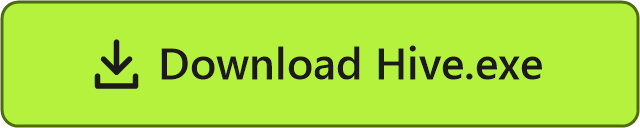
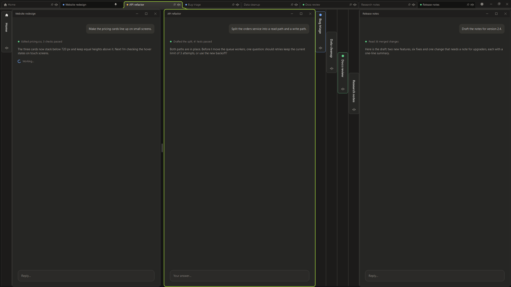
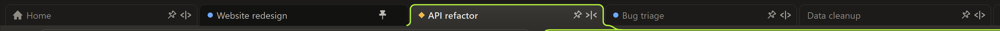
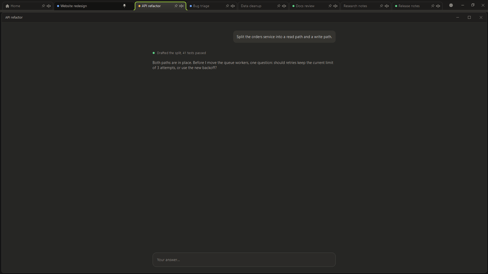
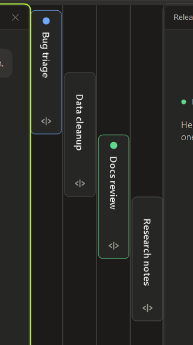

# Hive

**All your Claude desktop sessions in one window: tabs on top, side-by-side columns below, and every session back where you left it.**

For Windows 10 and 11. Before the first run, see [Download](#download): one Windows setting to turn off, and what to do if Windows warns about the file.

All screenshots use demo sessions, drawn by Hive's own drawing code. No real work is shown.

---

**Hive is a split-screen tool for the Claude Code desktop app on Windows.**

The Claude desktop app can open each Claude Code session in a window of its own. That's great for running several at once, until you have eight windows stacked on top of each other and no idea which one has finished, which is still working and which is waiting for an answer.

Hive is a small, free Windows program that gathers those windows into one place and splits the screen between them. Each session gets a tab, as in a browser. The sessions you're working with stand side by side at full height. The rest fold into slim bars you can open with one click. Every tab shows at a glance what its session is doing. Close Hive and the session windows go with it. Open it again, even after a restart, and every one is back where it was.

Hive doesn't replace or change Claude. Your sessions stay real Claude windows: Hive only arranges them, and reads the app's own status files to know what each session is doing.

## What it does

**Tabs for every session.** One tab per session window, in the order you choose: drag a tab to move it. The main Claude window, the one with the sidebar, has a small home mark, so you always know where new sessions start. Its tab shows the name of the session the main window holds, and follows within a few hundredths of a second when you switch sessions there.

**Side-by-side columns.** Open sessions stand next to each other at full height. Drag the gap between two columns to make them wider or narrower, or double-click it to make them equal again. If there isn't room for another column, the session you used longest ago folds by itself, and it comes back when there is room again.

**Fold and pin.** Fold a session into a slim bar to keep it close without taking space. Neighbouring bars form a staircase, so every name stays readable. Pin a session and it stays open at its own width, whatever else you open or fold.

**See what every session is doing.** Each tab and each folded bar shows its session's state:

| Mark | Meaning |
|---|---|
| Blue dot, gently blinking | working |
| Green dot | finished, and you haven't looked yet |
| Amber diamond | waiting for you: a question, an approval card (Allow / Deny), or a stop in the middle |

**One session at full size.** Double-click a tab, or press F11 while you're in a session, and that session fills Hive with the tabs still on top. Do it again to bring the columns back.

**Close it, and everything comes back.** Press Hive's × and Hive closes together with its session windows; your sessions themselves stay safe in Claude's sidebar. Click the Hive icon and every session window returns to its place, pinned or folded as before, the way a browser brings back its tabs. That also works after a PC restart, and it never touches your mouse or keyboard while it does it.

**Hive Home: its × is hidden.** The main Claude window, the one with the sidebar where new sessions start, is Hive's Home. Its tab and its folded bar carry a house mark. Its own × is hidden under a cover, so Home can't be closed by accident. If it closes another way, Hive opens it again within seconds.

**Light on your PC.** Measured on a 4K screen: about 0.5 % of one CPU core while waiting in the background, about 2 % while you work, and up to about 8 % while several sessions are working at once (their marks blink). Nothing is sent anywhere.

**Small touches.**
- Folded bars step down like a staircase, so names never overlap.
- A lime outline marks the session you're working in, and a lime line connects it to its tab.
- Hive can start with Windows and wait quietly until Claude opens.
- It follows each screen's scaling, from 1080p to 4K.
- Minimizing one session minimizes all of Hive, and the taskbar brings it back.

 

## What Hive changes about Claude's windows

Hive doesn't touch Claude itself, only how its windows behave while they're inside Hive:

| In Claude's window | Inside Hive |
|---|---|
| Home's × | hidden, so the main window can't be closed by accident |
| Home's width | at least 960 px at 100 % scaling, because Claude shows Home's sidebar only from about 950 px |
| a window set to stay on top | Hive turns stay-on-top off while the window is inside Hive, so the taskbar stays in front |
| a folded session that Claude itself brings forward while you work in another one | stays folded, and the keyboard stays with the session you're in (Claude does this, for example, when a session uses its built-in browser) |
| a session's maximize button □ | that session fills Hive, with the tabs still on top; press it again to go back to columns |
| a session's minimize button – | all of Hive minimizes together, to one Hive button on the taskbar |
| dragging a session's left or right edge | resizes its column, and the neighbours follow |
| moving a session out of place by hand | Hive puts it back into its column a second later |
| Hive's × | closes Hive together with every session window; the Hive icon brings them all back |
| the keyboard | Hive never takes it: you keep typing where you are |

## Before you start: turn off Windows' own split menu

Windows has its own split feature, **Snap layouts**: when you rest the pointer on a window's maximize button, it pops up a menu of screen layouts. Inside Hive, Hive does the splitting, and that pop-up only gets in the way over every session's maximize button. Turn it off once, either way:

- **In Windows:** Settings → System → Multitasking → Snap windows → untick **"Show snap layouts when I hover over a window's maximize button"**.
- **Or with Hive's script:** double-click **`tools\snap_layouts_off.bat`**. `tools\snap_layouts_on.bat` turns it back on.

Only that one pop-up is turned off. Win+Z and dragging a window to a screen edge keep working.

## Requirements

- Windows 10 or 11.
- The Claude desktop app for Windows, with Claude Code sessions opened in their own windows ("Open in new window", or Ctrl+click a session in the sidebar).
- Nothing else. Hive is built with the C# compiler that is already part of Windows (.NET Framework 4.8).

## Download

1. Download **Hive.exe** from the [latest release](https://github.com/Berry4241/Hive/releases/latest) and put it in a folder of its own.
2. Turn off Windows' split menu (see above), once.
3. Run `Hive.exe`.

Hive.exe isn't signed, so Windows may show **"Windows protected your PC"**: click **More info**, then **Run anyway**. Each release's Hive.exe is built from that release's source with `build.bat`, and the release notes give its SHA-256 so you can check the file. If you'd rather not run a downloaded program, build it yourself instead.

## Build it yourself

1. Download this repository: the green **Code** button → **Download ZIP**, then unzip it (or clone it with git).
2. Double-click **`build.bat`**. It makes `Hive.exe` next to it in a few seconds and installs nothing.
3. Turn off Windows' split menu (see above), once.
4. Run `Hive.exe`.

Either way, Hive keeps its settings and log in a `data` folder next to `Hive.exe`. To remove Hive, delete its folder.

## Use

| You do | Hive does |
|---|---|
| Click a tab | that session becomes the one you work in (a folded one unfolds) |
| Double-click a tab, or press F11 | that session fills Hive; again: back to columns |
| Click the ‹\|› mark, or a folded bar | the session opens as a column |
| Click the ›\|‹ mark on a tab | the session folds into a slim bar |
| Click the pin mark | the session stays open at its width until you unpin it |
| Drag a tab | the tabs, and the columns, take the new order |
| Drag the gap between columns | the columns get wider or narrower |
| Double-click the gap | the open columns become equal |
| Press Hive's × | Hive and its session windows close; the Hive icon brings them back |
| Gear menu | start with Windows, the desktop icon, and which screen Hive uses |

## How it works

- **Finding and arranging.** Hive looks for the Claude app's windows and moves and sizes them with ordinary Windows calls. Folded sessions wait behind Hive at the width they'll open at, so switching is instant.
- **Status.** Hive reads the Claude app's own local files, read-only: its session records under `%LOCALAPPDATA%\Claude-Data`, and the end of each session's transcript under `%USERPROFILE%\.claude\projects`. It never writes to them.
- **Approvals.** When a session waits on a tool call, Hive looks in that window for Claude's approval card (its Deny button), through Windows UI Automation, read-only: 3, 10 and 30 seconds after the session's last activity, then once a minute. A card that is there turns the tab amber.
- **Home's name.** Hive reads the name of the session shown in the main window from that window's own header, through Windows UI Automation, read-only. It looks 20 times a second, and each look takes about a tenth of a millisecond.
- **Bringing sessions back.** Hive remembers which session windows were open, and each one's session, so a session you rename in Claude comes back under its new name, in its old place. When one is missing, it finds that session in Claude's sidebar through Windows UI Automation and opens it in its own window with the same Ctrl+click you would use. The click is sent to Claude as a window message, so your real mouse and keyboard are never used.
- **What it writes.** Only its own `data` folder: `settings.json`, `start_positions.json`, and `hive.log` with one older copy, each kept under 2 MB.
- **What it never does.** No network, no accounts, no telemetry. It never deletes, changes or ends a Claude session. The × closes session windows only; the sessions stay in Claude's sidebar.

## Good to know

- **Unofficial.** Hive relies on details of the Claude desktop app, such as window titles, file names and sidebar labels, that can change with any Claude update. If an update breaks something, please open an issue.
- **Tested on one setup.** Windows 11 with a 4K screen at 100 % scaling, plus a second 1440p screen. Other scalings are supported but less tested.
- **Bringing sessions back, the name on Home's tab and the amber mark for approvals** need Claude's interface in English. The session must also appear in Claude's sidebar, not inside a collapsed section. If two sessions share a name, the first one in the sidebar is used.
- **Sessions that are still working.** Hive closes only the window, and the session itself is expected to carry on in Claude. This hasn't been seen with a session that was mid-task, so let a busy session finish before pressing the ×.

## Command line

| Command | What it does |
|---|---|
| `Hive.exe --background` | start quietly and wait for Claude (used by "Start with Windows") |
| `Hive.exe --selftest` | write what Hive sees (screens, Claude windows, session status) to `data\selftest.txt` |
| `Hive.exe --startup on` / `off` | add or remove the start-with-Windows shortcut |
| `Hive.exe --desktop on` / `off` | add or remove the desktop icon |

## Screenshots

The pictures in `docs/screenshots` are made by `tools\screenshots\make_screenshots.bat`. It draws Hive with Hive's own drawing code and a set of demo sessions, never with real windows or real data. The session windows in the pictures are simple stand-ins for Claude's.

## License

**Public domain, no copyright** ([The Unlicense](LICENSE)). Anyone may use, copy, change, share and build on Hive, for any purpose, with no permission needed and nothing to credit.

Hive is an independent project. It is not made by, endorsed by or affiliated with Anthropic. "Claude" is a trademark of Anthropic, used here only to say which app Hive works with.
